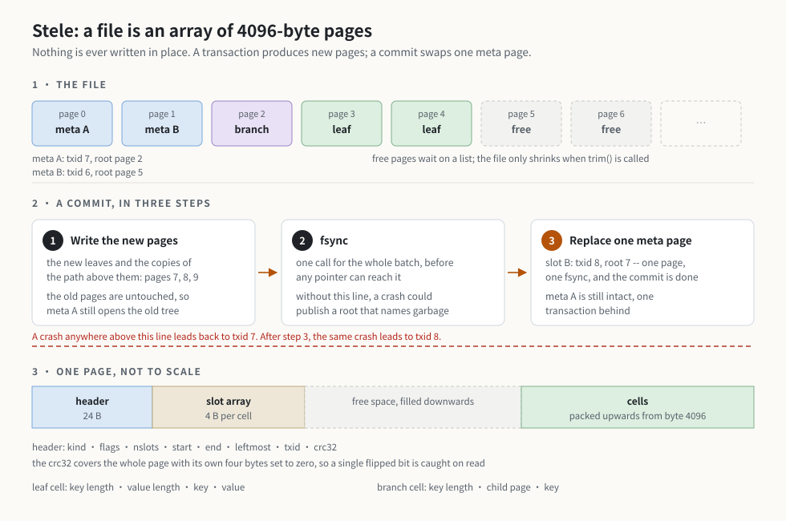

# stele

**A key/value store built on a copy-on-write B+tree, in pure Python, whose whole point is the sentence below.**

> A transaction is either entirely there or entirely absent — even if the power is cut during the commit.

That sentence is easy to write and hard to earn, so this repository treats it as a test rather than a promise.
A commit is **3 page writes**; the test interrupts the process at every single one of them, twice (clean and with a
torn sector), reopens the file, and checks it against a model. Six runs, six verified databases, five on the old
state, one on the new, **zero mixtures**.

- No dependencies. Standard library only, Python 3.10+.
- One file, 4096-byte pages, no write-ahead log.
- Snapshots cost an integer.
- `verify` walks every page and every invariant, and tells you which page broke.
- 169 tests, run on Linux, macOS and Windows across Python 3.10–3.13.



---

## Contents

- [Why another key/value store](#why-another-keyvalue-store)
- [Quick start](#quick-start)
- [What it does](#what-it-does)
- [How it works](#how-it-works)
- [Measurements](#measurements)
- [Command line](#command-line)
- [Library](#library)
- [Tests](#tests)
- [Project layout](#project-layout)
- [Limits and non-goals](#limits-and-non-goals)
- [Bugs this project caught in itself](#bugs-this-project-caught-in-itself)
- [License](#license)

## Why another key/value store

The usual way to make a store crash-safe is to write a log first: append the change, fsync, then modify the page
in place, then checkpoint. It works, and SQLite has polished it for twenty years. It also means two copies of the
truth (the log and the page), a recovery pass that replays, and a checkpoint policy.

Stele takes the other road, the one LMDB takes: **never modify a page**. Every change is written to fresh pages,
and the only thing that has to change atomically is a pointer to the root. That pointer lives in a 24-byte meta
page, and there are two of them, so "atomically" reduces to "write one page and fsync".

What you pay for it is write amplification and disk space. What you get is:

- a commit protocol you can hold in your head, and audit in twenty lines;
- recovery that is just "read two pages, take the newer one that still works";
- snapshots that cost an integer, because a reader only needs the root page id it started from;
- an abort that is free, because nothing was overwritten.

This is not a database server. It is an embedded engine, small enough to read in an evening, with the crash story
actually tested instead of asserted.

## Quick start

Nothing to install. From a checkout:

```console
$ python run.py put notes.db title "a stone tablet"
put 'title' (14 bytes) in transaction 1

$ python run.py put notes.db era "bronze age"
put 'era' (10 bytes) in transaction 2

$ python run.py scan notes.db
key    value
─────  ──────────────
era    bronze age
title  a stone tablet

$ python run.py get notes.db title
a stone tablet

$ python run.py stat notes.db --deep
txid      2
root      page 3
pages     4 (16.0 KiB), 1 free, 0 held for readers
file      4 pages on disk
items     2 keys in 1 leaf, depth 1

$ python run.py verify notes.db
ok: 2 keys, 1 leaf, 0 branches, depth 1, 1 free page

$ python run.py del notes.db era
deleted 'era'

$ python run.py get notes.db era
no value for 'era'
$ echo $?
3
```

Two demos worth running first:

```console
$ python run.py demo crash     # cut the power at every write of a commit
$ python run.py demo batch     # what batching actually buys
```

Or install the console script:

```console
$ pip install .
$ stele --version
stele 1.0.0
```

There is nothing to configure and no service to start. A store is one file; delete it and the database is gone.

## What it does

**Ordered key/value storage.** Keys and values are `bytes`. Ordering is byte order, so `b"user:10"` sorts before
`b"user:9"` — choose your key layout accordingly. Keys are limited to 512 bytes and values to 3500 bytes, because a
leaf cell has to fit in a page.

**Transactions.** One writer at a time, many readers. `with store.write() as writer:` gives you `put`, `delete`,
`get`, `scan`, and either commits on a clean exit or rolls back on an exception. Reads inside a transaction see its
own uncommitted writes.

**Snapshots.** `store.snapshot()` returns a read-only view pinned at one transaction. It holds a root page id and a
number; nothing is copied. Pages it can still reach are held back from the free list until it closes — that is the
whole cost, and `stat` shows it as `held for readers`.

**Crash safety.** Two meta pages, alternating. A commit writes its new pages, fsyncs, writes the *other* meta page,
fsyncs. Whichever meta page is newest and still consistent wins at open time; if the newest one is damaged, the
older one is used and the in-flight transaction disappears whole.

**Verification.** `store.verify()` walks the tree from the meta page and checks: every page decodes and passes its
CRC32, no page is reachable twice, all leaves are at the same depth, keys inside a page are strictly increasing,
keys are inside the range their parent claims, and separator keys are increasing. It returns the offending page id.

**Space management.** Freed pages go on a free list and are reused. `trim()` gives the tail of the file back to the
filesystem when everything above the highest reachable page is free.

**Interfaces.** A library, a CLI with eight subcommands and four documented exit codes, three benchmark suites,
five self-checking demos, and three runnable examples.

## How it works

### The page

Every page is exactly 4096 bytes: a 24-byte header, a slot array of 4-byte entries growing down from the front,
free space in the middle, and cells packed up from the end.

| Field | Size | Meaning |
| --- | --- | --- |
| `kind` | 1 | 0 free, 1 meta, 2 branch, 3 leaf |
| `flags` | 1 | reserved, must be zero |
| `nslots` | 2 | how many cells |
| `start` | 4 | first byte after the slot array |
| `end` | 4 | first byte of the cell area |
| `leftmost` | 4 | branch pages: the child that covers everything below the first key |
| `txid` | 4 | the transaction that created the page |
| `crc32` | 4 | over the whole page, with these four bytes set to zero |

A leaf cell is `<HH>` key length, value length, then key, then value. A branch cell is `<HI>` key length, child page,
then key. Slot *i* points at cell *i*; cells are appended in key order and never moved, so the slot array is the
order.

`decode()` trusts nothing. It checks the length, the checksum, that `start` matches `nslots`, that the cell area is
inside the page, and that every slot points at a self-consistent cell. A single flipped bit anywhere in the page
fails the checksum — the test suite flips bits one at a time and expects every one to be caught.

### The tree

A B+tree, with the copy-on-write discipline applied at the page level: a modification reads the path from the root,
writes new pages for every node on it, and returns a new root id. Old pages are untouched and unreachable from the
new root, which is exactly what makes snapshots free.

Insertion splits a node when it no longer fits. Deletion **does not rebalance**: a leaf that loses a key keeps its
remaining keys, and an empty leaf is unlinked from its parent. Merging siblings would shrink the tree, but it means
touching pages a delete did not need to touch, and every extra page is another page a crash can interrupt. The cost
is visible in the benchmarks: after deleting every row, the file is still as big as it was, until `trim()` is called.

### The commit

This is the entire durability argument:

```
write the new pages            (they are unreachable -- nothing points at them yet)
fsync                          (now they are on the medium)
write one meta page            (slot = 1 - current: page_count, root, txid + 1)
fsync                          (now the new root is published)
```

A crash before the second step leaves the old meta page in place, naming the old root, whose pages were never
touched. A crash during or after it either leaves the old meta page (the write did not land) or the new one (it
did). There is no third outcome, because there is no moment at which the *only* record of the new root is half
written: a page either passes its checksum or is ignored, and there is always one other meta page that predates the
whole transaction.

Two details matter:

- **The first fsync is skipped when nothing was written.** A transaction that only deletes pages may end up with no
  new page to write at all; then there is one write and one fsync, and that is still atomic.
- **Torn writes.** Devices write whole sectors, so a 4 KiB page can arrive with its tail missing. The tests simulate
  it: everything unsynced is lost, plus one page that keeps only its first 512 bytes. Because pages are
  self-checking, a torn page is simply an invalid page. The nastiest case — the meta page loses its *first* sector —
  is tested too; the older meta page takes over and the transaction vanishes whole.

### Snapshots and the free list

A page freed by a committed transaction cannot be reused immediately: a reader that started earlier may still be
able to reach it. Freed pages therefore enter a *pending* list tagged with the transaction that dropped them, and
move to the real free list only when no live snapshot predates that transaction. `stat` reports the two numbers
separately:

```
pages     42 (168.0 KiB), 3 free, 118 held for readers
```

A reader is cheap and its bill is deferred: 1,000 rows, three full rewrites, one open snapshot — the file grew from
18 to 138 pages because none of the 123 superseded pages could be recycled while the reader was there. Close it and
they all come back at once.

### Pages that were never durable

There is one more category, and getting it wrong was the most instructive bug in the project. A page that is created
*and* dropped inside the running transaction was never written to the medium, so no committed version can name it and
no snapshot can reach it. It goes straight back into the allocation pool instead of waiting for the commit.

Without that rule, one large transaction allocates a fresh page id for every path copy it ever makes. The benchmark
said it plainly: 20,000 rows committed at once occupied **198 MiB**, while the same rows committed a hundred at a time
occupied 2.9 MiB. With the rule, 20,000 rows cost 495 pages whether they arrive in one transaction or twenty
thousand:

```
20,000 rows, 820.3 KiB of logical data
  batch      1:   497 pages ( 1.94 MiB),  72,004 page writes
  batch    100:   498 pages ( 1.95 MiB),   1,205 page writes
  batch 20,000:   495 pages ( 1.93 MiB),     493 page writes
```

Batching is now purely a trade between fsyncs and memory: a big transaction holds every page it wrote until it
commits. The file stopped caring, which is what it should do.

### Recovery and trim

Opening a store reads both meta pages, decodes whatever is readable, sorts by transaction id and takes the newest
one whose root is reachable. Everything else in the file — pages written by an interrupted commit, pages freed by
later ones — is unreachable, so it becomes the free list. Recovery therefore *cleans up*: a crash does not leak
space, it just leaves some pages to be reused.

`trim()` walks the tree, finds the highest reachable page, and if everything above it is free, truncates the file
and rewrites a meta page to record the new size. On 3,000 rows:

```
3,000 rows built with batches of 100: 69 pages (276.0 KiB)
after deleting every row:          69 pages (276.0 KiB)
after trim:                        2 pages (8.0 KiB)
tree is empty: True, verified: True
```

## Measurements

Every number below comes from `python run.py bench <suite>` or `python run.py demo <name>` on one machine — Windows
11, Python 3.13, one core of an i9-14900HX — with the clock stopped around the workload, the garbage collector
disabled, and an in-memory device, so the numbers describe the engine rather than this disk. Run them yourself;
they are not tuned constants.

### `bench core`

```
workload             rows       rate  bytes/row  amplify     time  pages
─────────────────  ──────  ─────────  ─────────  ───────  ───────  ─────
insert-sequential  10,000    7,084/s      101 B     2.4x   1.41 s    247
insert-random      10,000    7,766/s       75 B     1.8x   1.29 s    182
point-reads        20,000  237,738/s        0 B        -  84.1 ms      0
update-in-place    10,000    2,230/s       48 B     2.6x   4.48 s    116
range-scan-1000     1,000  486,736/s        0 B        -   2.1 ms      0

5 workloads, 51,000 rows, 545 page writes, 7.27 s total
```

- **`pages` is the honest number.** Ten thousand sequential inserts write **247 pages**, not ten thousand records:
  the tree is what gets written. That is the copy-on-write signature, and it is why a commit can be atomic.
- **`bytes/row` is 101 B against 42 B of logical data** (2.4×): each insert copies the leaf it lands in *and* the
  branch above it.
- **Updates are slower than inserts** because an update rewrites a leaf, and that leaf holds ~270 small entries. The
  cost of a put scales with how much fits in a 4 KiB page, not with the size of the value.
- **Reads are cheap when the page cache is warm**, which is the case here: the tree was built by the same process a
  moment earlier. A cold process pays a CRC32-checked decode per page on first touch.
- **Scans beat point reads** because reading one leaf yields a hundred rows.

### `bench file` — the price of fsync

One transaction per row, real file, real `os.fsync`:

```
workload          rows     rate  bytes/row  amplify      time  pages
────────────────  ────  ───────  ─────────  ───────  ────────  ─────
file-commit-each   500  1,658/s    10871 B   639.5x  301.6 ms  1,327
```

1,658 commits per second, 2.65 page writes each (a leaf, a branch and a meta page), and 10.8 KiB written per row
because a page is 4 KiB and you cannot write less than a page. The amplification figure of 639× is not a bug; it is
what "durable" costs when the logical record is 17 bytes. Batch your writes and it drops by two orders of magnitude.

### Crash matrix

```
commit needs 3 page writes
6 of 6 crash runs recovered and verified
  landed on the old state: 5
  landed on the new state: 1
  of which torn sectors:   3
matrix took 28.7 ms
```

The matrix is generated, not written down: the harness counts the writes the commit will need, then re-runs it once
per write with the power cut at exactly that write, half of them with a torn sector. Both outcomes are legal; a
third — an unreadable file, a mixture, a lost transaction that had committed — is a test failure. The unit test
version of this runs against a 200-row tree, a deep tree, a file that loses its newest meta page, and twelve
consecutive random crashes checked against a model.

### What batching buys

2,000 rows, committed at different sizes (`python run.py demo batch`):

```
batch  writes / row  file pages  file size
─────  ────────────  ──────────  ─────────
    1          2.98          53  212.0 KiB
   10          0.32          54  216.0 KiB
  100          0.05          54  216.0 KiB
1,000          0.03          54  216.0 KiB
4,000          0.03          52  208.0 KiB
```

A hundredfold reduction in page writes, and the file does not notice. If you take one thing from this README, take
this: **batching is the main performance knob, and its currency is memory, not disk.**

## Command line

```
stele put    FILE KEY VALUE      write one key
stele get    FILE KEY            read one key
stele del    FILE KEY            remove one key
stele scan   FILE [--low L] [--high H] [--limit N]
stele stat   FILE [--deep]       page and tree statistics
stele verify FILE                check every page and invariant
stele bench  [quick|core|file]   benchmark suites
stele demo   [basic|snapshot|crash|batch|reclaim]
```

Every command takes `--json` and prints one object instead of a table, which is what the tests use. Exit codes are
part of the contract:

| Code | Meaning |
| --- | --- |
| 0 | the command did what it said |
| 1 | the file could not be read or understood |
| 2 | the arguments are wrong |
| 3 | the answer is "no": no such key, empty range, or verification failed |

```console
$ python run.py get notes.db missing --json
{
  "key": "missing",
  "found": false
}
$ echo $?
3
```

`scan` counts wide characters as two cells, so a table with Chinese values still lines up in a terminal. `stat`
tells you how much of the file is free and how much is pinned by readers; `verify` tells you exactly which page
broke and why.

## Library

```python
from stele import Store

with Store.open("app.db") as store:
    with store.write() as writer:          # one writer at a time
        writer.put(b"user:1", b'{"name":"ada"}')
        writer.put(b"user:2", b'{"name":"grace"}')
        assert writer.get(b"user:1") == b'{"name":"ada"}'

    print(store.get(b"user:1"))

    with store.snapshot() as snap:         # a consistent read-only view
        for key, value in snap.scan(b"user:", b"user;"):
            print(key, value)

    print(store.verify().ok)               # walks every page
    print(store.stats(deep=True).items)    # counts keys
```

`Store(disk)` accepts any device: `MemoryDisk()` for tests, `FileDisk(path)` for a file, `CrashDisk(...)` to lose
power on purpose. `Store.memory()` is a one-liner for the first case.

Errors are `StoreError` (the store cannot be opened, or the call is not allowed now), `PageError` (a page failed to
decode) and `DiskError` (the device returned something that cannot be a page). A transaction that raises rolls back;
nothing is left half-applied.

## Tests

```console
$ python run_tests.py
...
Ran 169 tests in 48.5s

OK
```

| File | Cases | What it pins down |
| --- | --- | --- |
| `test_page.py` | 24 | round-trips, limits, every malformed-page path, one flipped bit at a time |
| `test_btree.py` | 11 | the tree against a `dict` model, 5,000 ordered keys, 4,000 random operations, scans |
| `test_disk.py` | 13 | memory, file and crash devices, including what a crash actually loses |
| `test_store.py` | 28 | commits, rollback, snapshots, page reuse, reopening, verification, broken meta pages |
| `test_crash.py` | 7 | every crash point × clean/torn, deep trees, twelve consecutive crashes, orphan reclamation |
| `test_render.py` | 24 | CJK column widths, alignment, unit formatting |
| `test_bench.py` | 23 | derived rates, the crash matrix, batching, footprint |
| `test_demos.py` | 10 | every demo's claims, recomputed from scratch |
| `test_cli.py` | 29 | all eight subcommands, JSON output, exit codes 0/1/2/3, a deliberately broken tree |

The crash tests are the reason the project exists, so they are worth reading first: they never trust the engine's own
report, they reopen the file with a fresh `Store` and ask it questions.

CI runs the suite on Ubuntu, macOS and Windows for Python 3.10, 3.11, 3.12 and 3.13, then builds a wheel, installs
it into a clean virtualenv and drives the installed `stele` command. Thirteen jobs, none of them allowed to fail.

## Project layout

```
stele/
├── stele/
│   ├── page.py          page layout, cells, CRC32, strict decoding
│   ├── disk.py          memory / file / crash-injecting devices
│   ├── btree.py         copy-on-write B+tree; no I/O, no transactions
│   ├── store.py         meta pages, commits, free list, snapshots
│   ├── render.py        terminal tables that count CJK as two cells
│   ├── bench.py         workloads, crash matrix, footprint
│   ├── demos.py         five demos, each asserting its own numbers
│   └── cli.py           eight subcommands, four exit codes
├── tests/               169 cases, one file per concern
├── examples/
│   ├── tour.py          load, read, edit, delete, trim — with a real file
│   ├── snapshot_tour.py a reader that survives three rewrites of everything
│   ├── crash_tour.py    power loss at every write of a commit
│   └── data/glossary.tsv
├── docs/architecture.svg
├── run.py               the CLI without installing
├── run_tests.py         the suite without pytest
├── run_demos.py         all five demos
├── pyproject.toml       package `stele-store`, console script `stele`
└── .github/workflows/tests.yml
```

The layering is strict: `page` knows bytes, `disk` knows pages, `btree` knows a `NodeContext` protocol (read, alloc,
write, free), and `store` is the only module that knows about time — transactions, meta pages, readers, reclaiming.
That is why the tree can be tested against a dictionary with no disk at all, and why the crash tests can drive the
real `Store` without mocking anything.

About 2,450 lines of engine, 1,700 lines of tests, 350 lines of examples. No generated code, no vendored files.

## Limits and non-goals

Stated plainly, because a storage engine that hides its edges is worse than one that has them:

- **One process, one writer.** There is no file locking. Two processes opening the same file will corrupt it. If you
  need that, use SQLite.
- **No delete rebalancing.** Empty leaves are unlinked; siblings are never merged. Space comes back through the free
  list and `trim()`, not through tree shrinkage.
- **`trim()` only truncates the tail.** Interior holes are reused but never returned to the filesystem.
- **Snapshots pin pages.** A reader that stays open while the database is rewritten makes the file grow. That is the
  price of not copying.
- **Small values.** 512-byte keys, 3500-byte values, one 4 KiB page. No overflow pages.
- **CRC32, not a MAC.** It catches corruption, not tampering. No encryption, no compression.
- **Not fast by database standards.** ~7,000 inserts/s and ~240,000 point reads/s in Python. If you need a million
  operations per second, this is the wrong layer of the stack — but the ideas transfer.
- **Not SQL.** No schema, no types, no query planner. Keys and values are bytes; ordering is byte order.

## Bugs this project caught in itself

Kept because they are the honest part of the story, and because most of them were found by a measurement rather
than by reading the code:

1. **A 16-bit field where 32 bits were needed.** The page header struct was `<BBHHIII`, so `end` decoded as
   267,653,120. Every fresh leaf looked corrupt.
2. **The decoder used the wrong upper bound.** Cells were validated against the end of the cell area instead of the
   end of the page, so a valid page with free space was rejected.
3. **`verify()` compared the first key of a leaf with itself**, because the range floor was used as the "previous"
   key. Every non-empty leaf failed.
4. **A commit wrote 61 pages instead of 2.** The dirty set still held pages that the transaction had created and
   then dropped; they were written even though nothing pointed at them. Filtering them cut the crash matrix from 122
   experiments to 6.
5. **The torn-write test was testing nothing.** Zeroing the tail of a page left the meta page perfectly readable, so
   every assertion passed for the wrong reason. Losing the *first* sector is the tear that can actually hurt, and
   there is now a test for it.
6. **The allocator held pages that had never been durable.** Pages created and dropped inside one transaction waited
   for the commit, so a single 20,000-row transaction occupied 198 MiB for 700 KiB of data. This one was found by
   the footprint benchmark, not by a failing test.
7. **Fixing that leaked pages.** The reuse pool was discarded at commit instead of being returned to the free list,
   so `trim()` stopped working and 32 pages per 3,000-row load became unreachable. Found by re-running the reclaim
   benchmark.
8. **Benchmarks that measured the setup.** Point reads included the time to build the tree; `point reads` reported
   8,093/s instead of 237,738/s.
9. **Benchmarks that measured the previous benchmark.** Garbage from the last workload was collected inside the next
   one's timed region, making point reads look 3.5× slower than the same code one run earlier.
10. **A hot field rebuilt on every access.** `Page.keys` allocated a tuple of a hundred keys per call, which turned
    every lookup into a walk over the whole page: 41,000 reads/s. Computed once at decode time: 311,000/s.

## License

MIT. See [LICENSE](LICENSE).
